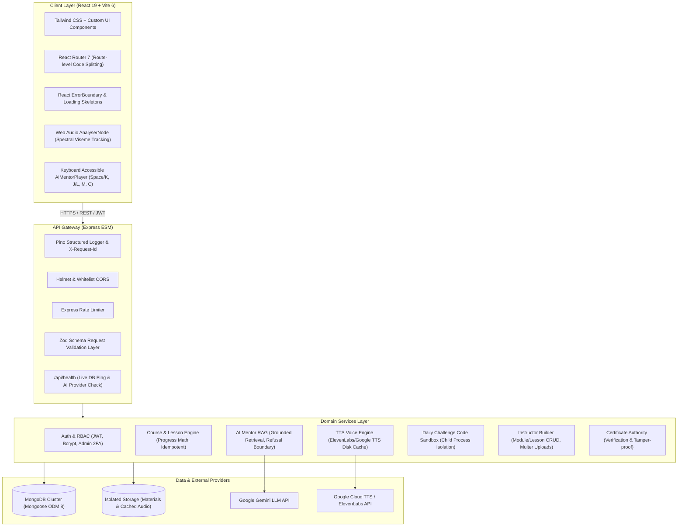

# UptoSkills AI LMS — Fullstack Production Platform

[](.github/workflows/ci.yml)
[](https://nodejs.org/)
[](https://react.dev/)
[](https://mongoosejs.com/)
[-success.svg)](eslint.config.js)
[](server/tests/)

An enterprise-grade, ethically grounded Learning Management System (LMS) built with **React 19**, **Node.js (Express ESM)**, **MongoDB (Mongoose)**, and **Google Gemini AI**. Learners study interactive, structured curriculum guided by pedagogical AI mentors featuring real speech synthesis, real-time Web Audio viseme-driven avatars, grounded RAG doubt resolution, and gamified XP leagues.

---

## 🏛 System Architecture



---

## 🌟 Implemented Features & Technical Capabilities

### 1. Ethical AI Mentorship & Digital Likeness Consent
- **Strict Legal Taxonomy**: All mentors are classified as `original`, `licensed`, `historical`, or `consented-person`. Zero living individuals are impersonated without consent.
- **Ten Original & Historical Mentors**: Includes Ada Lovelace (historical) and 9 original fictional mentors (Dr. Alex Vance, Dr. Siddharth "Sid" Rao, Elena Montague, Dr. Kai Jensen, Coach Vik Malhotra, Samar Roy, Anya Sharma, Marcus Chen, and Dr. Irene Thorne).
- **Mandatory Disclosure**: Persistent, unremovable badge `"AI-generated mentor. Not the real person."` rendered in the video player, lesson transcripts, and chat turns.
- **Administrative Activation Gate**: Mentors cannot be activated without verified `consentDocUrl` or `licenseInfo` documents on record.

### 2. Grounded AI Mentor RAG Service
- **System/User Turn Separation**: Enforces strict prompt injection boundaries by placing student messages exclusively in user turns and syllabus context in system instructions.
- **Syllabus Boundaries & Refusal Policy**: Grounds replies on top-k cosine similarity chunks of current course curriculum. Explicitly refuses off-syllabus queries with polite, informative boundaries.
- **Section Footnote Citations**: Returns exact lesson section citations (`[Module X > Lesson Y]`) with every mentor answer.
- **Session Persistence & History**: Maintains conversation history (last $N$ turns) stored in MongoDB per user and course.

### 3. Real Text-to-Speech (TTS) & Talking Avatar
- **Audio Cache Engine**: Server endpoint `POST /api/ai/lessons/:lessonId/audio` generates voice segments using configured providers (ElevenLabs / Google Cloud TTS), securely keyed and cached on disk with word-level timestamps.
- **Accessible HTML5 Player**: `AIMentorPlayer` plays real cached audio with native browser fallback. Full keyboard navigation:
  - `Space` or `k`: Play / Pause
  - `ArrowLeft` / `j`: Seek backward 5s
  - `ArrowRight` / `l`: Seek forward 5s
  - `m`: Mute / Unmute
  - `c`: Toggle synchronized live closed captions
- **Web Audio Spectral Lip-Sync**: 2D vector talking avatar driven by real-time Web Audio API `AnalyserNode` fast Fourier transform (FFT) analysis. Deterministic phonetic visemes with smooth aperture transitions and natural stochastic micro-expressions.

### 4. Instructor Studio & Course Builder
- **Curriculum CRUD**: Drag-and-drop module and lesson reordering with server-enforced ownership checks.
- **AI Draft Generation**: AI-assisted lecture draft generator populating syllabus, script, and comprehension checks into `draft` status (never auto-published).
- **Review Workflow**: Multi-stage state machine (`draft` $\rightarrow$ `pending` $\rightarrow$ `approved` / `rejected`) recording reviewer identity and actionable rejection feedback.
- **Secure File Storage**: Lesson materials uploaded via `multer` with strict MIME/size whitelisting, stored **outside the web root** (`server/uploads/materials`) and guarded by authenticated enrollment checks.

### 5. Daily Challenge Real Code Sandbox
- **Subprocess Isolation**: Submissions run in isolated Node.js child processes with strict memory (128 MB) and execution timeout limits (3,000 ms), completely preventing `eval` or `new Function` on the main server thread.
- **Hidden Test Cases**: Hidden edge cases remain encrypted server-side and are never transmitted to the client.
- **Server-Side XP & Streaks**: XP and daily streaks are calculated and awarded once per challenge per calendar day server-side to prevent duplicate farming. Hint unlocks deduct XP server-side.
- **Advisory AI Code Evaluation**: AI code feedback is strictly advisory and cannot override sandbox test results or award XP.

### 6. Observability, Validation & Security
- **Pino Structured Logging**: Low-overhead structured JSON logging with request duration tracking, error telemetry, and automatic redaction of sensitive fields (`password`, `token`, `otp`).
- **Distributed Request IDs**: Every request is assigned an `X-Request-Id` UUID, tracked across logs and returned in HTTP response headers.
- **Deep Health Check**: `/api/health` performs a live MongoDB admin ping, checks AI provider readiness, and exposes system uptime and memory statistics.
- **Centralized Zod Validation**: All inbound HTTP request bodies are validated against typed Zod schemas, returning standardized error envelopes:
  ```json
  {
    "success": false,
    "code": "VALIDATION_ERROR",
    "message": "Validation failed",
    "errors": [{ "field": "email", "message": "Enter a valid email address." }]
  }
  ```

---

## 🗄 Mongoose Data Models

The platform uses 17 MongoDB Mongoose models with ObjectId references and compound indexes:

| Model | File | Primary Responsibility |
|---|---|---|
| `User` | `server/models/User.js` | User identities, hashed passwords, roles (`student`, `instructor`, `admin`), XP, streaks |
| `Mentor` | `server/models/Mentor.js` | Ethical AI personas, taxonomy, vocal profiles, consent documents, activation status |
| `Course` | `server/models/Course.js` | Course metadata, category, difficulty, pricing, approval state, ownership |
| `Module` | `server/models/Module.js` | Curriculum sections and ordering index |
| `Lesson` | `server/models/Lesson.js` | Lesson units, scripts, duration, attachments, quiz questions |
| `LessonProgress` | `server/models/LessonProgress.js` | Granular per-lesson watch state, playback position, and completion |
| `Enrollment` | `server/models/Enrollment.js` | Student-to-course enrollments with compound unique index on `{ userId, courseId }` |
| `Quiz` | `server/models/Quiz.js` | League assessments with questions and hidden server-side answers |
| `QuizAttempt` | `server/models/QuizAttempt.js` | Graded quiz submissions and scores |
| `Certificate` | `server/models/Certificate.js` | Tamper-proof graduation certificates with unique verification codes |
| `DailyChallenge` | `server/models/DailyChallenge.js` | Coding problems, starter code, visible test cases, and hidden test suites |
| `ChallengeSubmission` | `server/models/ChallengeSubmission.js` | User code submissions, per-test results, and runtime diagnostics |
| `ForumPost` | `server/models/ForumPost.js` | Technical discussion threads |
| `ForumComment` | `server/models/ForumComment.js` | Community discussion replies |
| `Review` | `server/models/Review.js` | Course ratings and student testimonials |
| `Notification` | `server/models/Notification.js` | In-app alerts, milestones, and system messages |
| `InstructorApplication`| `server/models/InstructorApplication.js` | Student applications to upgrade privileges to instructor |

---

## 🧪 Testing Suite & Quality Gates

The project maintains rigorous automated test coverage across both client and server:

### Test Execution Commands
```bash
# Run all automated tests (client + server)
npm test

# Run frontend Vitest + React Testing Library component tests
npm run test:client

# Run backend Supertest & Node.js native integration tests
npm run test:server

# Run ESLint quality gate
npm run lint

# Build production bundle
npm run build
```

### Coverage Highlights
- **Client Tests (`Frontend/**/*.test.jsx`)**:
  - `Login.test.jsx`: Form rendering, input validation, student sign-in, and 2FA admin access code flow.
  - `AIMentorPlayer.test.jsx`: Accessibility ARIA landmarks, ethics disclosure notice, play/pause controls, keyboard shortcuts (`C`, `M`), and caption synchronization.
  - `LeagueList.test.jsx`: League filtering, search, level categorization, and quiz attempt integration.
  - `ErrorBoundary.test.jsx`: Graceful component error catch, fallback UI, and recovery trigger.
- **Server Tests (`server/tests/*.test.js`)**:
  - `122 passing tests` across 38 suites covering authentication hardening, token expiry, privilege escalation defense, idempotent course enrollment, progress math, quiz sanitization, certificate verification, instructor course approval lifecycle, sandbox process timeouts, RAG citations, and ethical consent checks.

---

## 🚀 Quick Start Guide

### 1. Prerequisites
- **Node.js**: v20.x or higher
- **MongoDB**: v6.0+ (Local, Docker, or Atlas)
- **Google Gemini API Key**

### 2. Installation
```bash
# Clone the repository
git clone https://github.com/uptoskills/uptoskills-ai-lms.git
cd uptoskills-ai-lms

# Install root & frontend dependencies
npm install

# Install server dependencies
cd server && npm install && cd ..
```

### 3. Environment Setup
```bash
# Configure frontend environment
cp .env.example .env

# Configure backend environment
cp server/.env.example server/.env
```

Ensure `MONGO_URI` and `GEMINI_API_KEY` are populated in `server/.env`.

### 4. Database Seeding
Execute the idempotent seed script to populate mentors, courses, modules, quizzes, and demo users:
```bash
npm run seed
```

### 5. Start Development Servers
In two separate terminal sessions:
```bash
# Terminal 1: Backend API (Port 5001)
npm run server

# Terminal 2: Frontend Client (Port 5173)
npm run dev
```

Visit `http://localhost:5173` to access the application.

---

## 🔑 Demo User Credentials

The database seed provides pre-configured role accounts:

| Role | Email | Password | Access Code (2FA) |
|---|---|---|---|
| **Student** | `shailesh@uptoskills.com` | `student123` | N/A |
| **Admin** | `admin@uptoskills.com` | `admin123` | `123456` |
| **Instructor** | `priya.mentor@uptoskills.com` | `mentor123` | N/A |

---

## 🐳 Docker Deployment

A production-ready `docker-compose.yml` orchestrates MongoDB 7.0, the Node.js backend, and an Nginx-served static React 19 build:

```bash
# Build and launch all containers in detached mode
docker compose up -d --build

# Seed database inside the running container
docker compose exec server npm run seed

# Monitor real-time logs
docker compose logs -f
```

For detailed deployment guides for cloud platforms (Render, Railway, Vercel, Netlify), see [docs/DEPLOYMENT.md](docs/DEPLOYMENT.md).

---

## ⚠️ Known Limitations & Roadmap

While UptoSkills AI LMS implements an industry-grade architecture, the following engineering limitations are documented for full transparency:

1. **TTS Voice Fallback**: When external TTS provider API keys (`ELEVENLABS_API_KEY` or Google Cloud Speech credentials) are not supplied in the environment, the client falls back to the native browser `Web Speech API`. Voice timbre and naturalness in fallback mode depend on local operating system voices.
2. **2D Vector Avatars vs. 3D Meshes**: The talking avatar utilizes an efficient, zero-latency 2D SVG canvas model driven by real-time Web Audio spectral analysis. While responsive and performant across mobile devices, full 3D skeletal deformation (e.g. Three.js / Ready Player Me VRM models) is planned for a future major release.
3. **Subprocess Sandbox vs. Kernel Containerization**: The Daily Challenge sandbox executes user submissions in isolated Node.js child processes with time and memory ceilings. While securely preventing infinite loops and filesystem access, enterprise multi-tenant deployments should isolate untrusted code inside ephemeral rootless Docker containers or a dedicated judge cluster (such as Judge0).
4. **Local Vector Search Scale**: RAG grounding uses in-memory cosine similarity over lesson chunks stored directly in MongoDB. For course libraries exceeding 10,000+ lessons, migration to a dedicated vector index (e.g. MongoDB Atlas Vector Search or Milvus) is recommended.
5. **Single-Region Database**: Docker Compose deploys a single-node MongoDB instance with persistent volume storage. Production enterprise clusters should utilize MongoDB Atlas multi-region replica sets with automated backups.

---

## 📄 License & Compliance

Distributed under the MIT License. Developed for the UptoSkills Final-Year Project capstone. All synthetic avatars and voice profiles strictly adhere to the [UptoSkills Digital Likeness and Ethical AI Policy](docs/ETHICS_AND_CONSENT.md).
